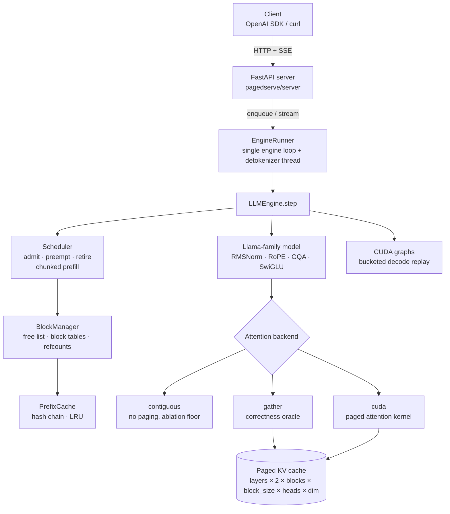

# PagedServe

[](https://github.com/Vivek-Chaudhari30/Paged_Serve/actions/workflows/ci.yml)


[](LICENSE)

**A from-scratch LLM inference server built around paged KV-cache memory management.**

PagedServe reimplements the core mechanisms that make vLLM, TensorRT-LLM and SGLang fast, and
imports none of them:

- **Paged KV cache.** Fixed-size blocks and per-sequence block tables replace preallocating
  `max_seq_len` per request, so the most a sequence wastes is `block_size - 1` slots.
- **Continuous batching.** An iteration-level scheduler admits, preempts (recompute or swap)
  and retires requests between decode steps.
- **Prefix caching.** Shared prompt prefixes reuse KV blocks: blocks are hashed as a chain,
  refcounted, copied on write and evicted LRU.
- **Custom CUDA paged attention.** A decode kernel reads K/V in place through the block table
  with an online softmax, plus scatter, copy and swap kernels, bound to Python via pybind11.
- **Chunked prefill and CUDA graphs.** Long prompts are split into chunks so they don't stall
  decodes, and pure-decode batches replay from bucketed CUDA graphs.
- **OpenAI-compatible HTTP API.** `/v1/completions` and `/v1/chat/completions` over FastAPI,
  with SSE streaming, full sampling, `n > 1` through block-table forking, and immediate block
  release when a client disconnects.

The model forward pass (RMSNorm, RoPE, GQA, SwiGLU) is hand-written too. HuggingFace
`transformers` is used only as the reference that output is checked against, never at runtime.

---

## Status

> **Correctness is verified on a GPU. Performance has not been measured yet.** There is no
> throughput or latency number anywhere in this repository, and there won't be until a
> benchmark sweep has run and its raw output is committed under `results/`.
> See [Results](#results).

| Phase | What it adds | State |
|---|---|---|
| 0 | Benchmark harness: load generator, metrics, HF baselines | ✅ complete |
| 1 | Hand-written Llama-family model, contiguous KV cache, golden test | ✅ complete |
| 2 | Paged KV cache, block manager, gather attention backend | ✅ complete |
| 3 | Continuous batching scheduler, recompute and swap preemption | ✅ complete |
| 4 | Custom CUDA paged attention and cache kernels (`cuda` backend) | 🟡 code complete, CPU-tested through reference ops, **not yet compiled or run on a GPU** |
| 5 | Block-aligned prefix caching with LRU eviction | ✅ complete |
| 6 | OpenAI-compatible server, streaming, full sampling | ✅ complete |
| 7 | Chunked prefill, CUDA graphs, async detokenization | 🟡 code complete; chunked prefill golden-verified on CPU; CUDA graphs not yet run on a GPU |
| 8 | Ablation flags, sweep driver, chart generation | 🟡 tooling complete; **no sweep run yet** |
| 9 | Design doc, vLLM gap analysis, design Q&A | 🟡 written; results sections wait on a sweep |

Phases 0–3, 5 and 6 have been verified on a CPU and on a Tesla T4. The remaining open item
is the same for every phase: **run the benchmark sweep on a pinned GPU**.

---

## Architecture



Each optimization sits behind a flag, and the slower path it replaced is kept as the
experimental control. `gather` stays in the tree permanently as the correctness oracle for
the CUDA kernel. [docs/design.md](docs/design.md) covers the request lifecycle, the scheduler
order, the kernel's thread layout and how CUDA graph padding works.

---

## Quickstart

### Install

```bash
git clone https://github.com/Vivek-Chaudhari30/Paged_Serve.git
cd Paged_Serve
pip install -e ".[all]"
```

The extras are split so the benchmark harness runs on a laptop with no GPU:

| Extra | Pulls in | Needed for |
|---|---|---|
| *(base)* | numpy | `bench/metrics.py`, `bench/loadgen.py` against the mock backend |
| `engine` | torch, safetensors, huggingface-hub | the engine itself |
| `server` | fastapi, uvicorn, pydantic | the HTTP server |
| `baseline` | transformers | the HuggingFace baseline and the golden test's reference |
| `dev` | pytest, ruff, matplotlib, httpx | tests, lint, charts |

### Build the CUDA extension (optional, GPU hosts only)

```bash
python setup.py build_ext --inplace
```

Build it explicitly. `pip install` builds in an isolated environment that has no torch, so the
extension would quietly fail to build. Without it, `import pagedserve` still works and the
engine falls back to the `gather` backend with a single warning. `setup.py` infers the GPU
architecture from the visible device rather than hardcoding `-arch`.

### Run the server

```bash
python -m pagedserve.server --model Qwen/Qwen2.5-0.5B-Instruct --num-blocks 512
```

```bash
curl http://127.0.0.1:8000/v1/chat/completions \
  -H "Content-Type: application/json" \
  -d '{"model": "Qwen/Qwen2.5-0.5B-Instruct", "messages": [{"role": "user", "content": "What is a KV cache?"}], "max_tokens": 64, "stream": true}'
```

`GET /health` reports the free-block count, so a KV leak shows up in production and not only
in a test. Pass `--num-blocks` explicitly for any run that must not OOM. Without a profiling
forward pass, automatic capacity sizing ignores activation memory and over-allocates.

The default target model is `Qwen/Qwen2.5-0.5B-Instruct`. It's ungated, so no HF token is
needed. It's Llama-style but uses Q/K/V biases and tied embeddings, and the loader reads both
from the checkpoint instead of branching on the model name.

### Ablation flags

| Flag | Effect |
|---|---|
| `--no-paging` | contiguous `max_seq_len` KV cache (the Phase 1 floor) |
| `--attn-backend {contiguous,gather,cuda}` | choose the attention path; defaults to `cuda` when the extension is built and a GPU is present, else `gather` |
| `--static-batching` | admit only into an empty engine (no continuous batching) |
| `--enable-prefix-caching` | reuse KV blocks across shared prompt prefixes |
| `--enable-chunked-prefill` | split long prompts into budget-sized chunks |
| `--enable-cuda-graphs` | replay pure-decode batches from captured graphs (`cuda` backend only) |
| `--preemption-policy {recompute,swap}` | what to do with a victim when blocks run out |
| `--block-size`, `--max-num-seqs`, `--max-num-batched-tokens`, `--swap-space-blocks` | capacity and budget knobs |

---

## Benchmarking

The harness was built before any optimization, so every phase can be measured against the
one before it.

```bash
# One run: closed-loop load against the engine, raw per-request timings to JSON
python bench/loadgen.py --backend pagedserve --model Qwen/Qwen2.5-0.5B-Instruct \
    --mode closed --concurrency 32 --num-requests 256 --max-tokens 128 \
    --output results/<run>.json

# Ablation sweeps: arms | block-size | preemption | prefix  (--dry-run prints the grid)
python -m bench.sweep arms --model Qwen/Qwen2.5-0.5B-Instruct \
    --dataset data/sharegpt.json --out results/arms

# Regenerate every chart from committed raw results
scripts/make_charts.sh results docs/charts
```

| Sweep | Compares |
|---|---|
| `arms` | contiguous+static, paged+static and paged+continuous across concurrency |
| `block-size` | block sizes 1 to 128 on the continuous arm |
| `preemption` | recompute vs swap under a starved cache |
| `prefix` | shared-prefix fraction 0 to 0.9, prefix cache off vs on |

The protocol is strict: one machine per result set with the GPU, driver, CUDA and torch
versions recorded; warm-up runs discarded; at least three runs with the median and spread
reported; P50/P95/P99 for every latency metric; Poisson arrivals for headline numbers; and
every chart regenerated from `results/`, never drawn by hand. Supporting scripts:
[`scripts/aws_bench.sh`](scripts/aws_bench.sh) (EC2 launch, sweep and teardown; see the
[runbook](docs/aws-runbook.md)), [`scripts/explorer_job.sbatch`](scripts/explorer_job.sbatch)
(SLURM, A100) and [`scripts/kaggle_bootstrap.sh`](scripts/kaggle_bootstrap.sh) (notebook GPUs).

---

## Results

`TODO(bench)`: **no performance has been measured.**

Every number that ends up here will trace back to a raw result JSON committed under `results/`,
produced by a script in `bench/`, on hardware named next to it. This repository has one rule
that comes before all the others: **no number goes in without a measurement behind it.** No
estimates, no figures from the literature, no illustrative placeholders. That rule is written
down in [AGENTS.md §2.1](AGENTS.md).

## What has been verified

None of what follows measures performance. These are correctness results and allocation
bookkeeping, which is why they are kept apart from Results.

**Correctness on a Tesla T4 (sm_75, float16 and float32):**

- **Golden gate:** greedy decoding matches a HuggingFace reference token for token, 44/44
  cases, on both the `contiguous` and `gather` backends, in both dtypes, with prefix caching on
  and off. A prefix-cache hit shortens the prefill, so the SDPA shape, kernel and reduction
  order all change, and the output is still identical.
- The paged and contiguous backends produce **bit-identical logits**.
- Forced preemption doesn't change the output under either the recompute or the swap policy.
- Every configuration is deterministic across repeated runs.
- The CUDA extension build canary passes 13/13, including a loader test in a fresh subprocess.

A shared, unpinnable T4 can't produce a timing worth reporting, so none of the above was timed.

**KV allocation bookkeeping** (4 prompts, `block_size=16`, CPU/fp32). This is allocated-vs-live
accounting, so it doesn't depend on the device, but it depends entirely on `max_seq_len` and
the workload:

| generated tokens | contiguous | paged |
|---|---|---|
| 16 | 2.1% | 68.0% |
| 48 | 5.1% | 80.9% |
| 96 | 8.6% | 87.8% |
| 256 | — | 94.4% |

Paged utilization rises with length because the only waste is in the last block, at most
`block_size - 1` slots, rather than everything up to `max_seq_len`.

---

## Testing

```bash
ruff check . && ruff format --check .
pytest -m "not gpu"        # CPU: everything except tests that cannot run without CUDA
```

CI runs both on every push and pull request. Tests mark what they need:
`@pytest.mark.gpu` for a CUDA device and `@pytest.mark.cuda_ext` for the compiled extension.
On a CPU, the `cuda` backend runs against pure-PyTorch twins of the kernels
(`pagedserve/attention/paged_reference.py`), which have the same signatures and the same
online-softmax structure.

The golden test is the commit gate, and it is never loosened to make it pass. It skips (and
says so loudly) when the reference model isn't cached locally, so fetch it first with
`hf download Qwen/Qwen2.5-0.5B-Instruct`. The gate depends on the device it runs on, so
`pytest -m gpu` is **not** the GPU suite. To run the whole suite on a GPU:

```bash
PAGEDSERVE_TEST_DEVICE=cuda PAGEDSERVE_TEST_DTYPE=float16 pytest
```

Use float16 on Turing (T4) and Volta (V100). They have no native bf16, and
`torch.cuda.is_bf16_supported()` returns `True` on them anyway because it counts emulation.
`resolve_dtype` picks a dtype by compute capability instead.

---

## Repository layout

```
pagedserve/
├── config.py            EngineConfig / CacheConfig / SchedulerConfig / ModelConfig, device + dtype resolution
├── engine.py            LLMEngine.step(): schedule → batch assembly → forward → sample → retire
├── sequence.py          Sequence, SequenceGroup, SequenceStatus
├── extension.py         optional loader for the compiled CUDA extension
├── memory/              block.py, block_manager.py, prefix_cache.py
├── core/                scheduler.py, policy.py (RECOMPUTE | SWAP)
├── model/               loader.py, llama.py, layers.py, sampler.py
├── attention/           backend.py (ABC), contiguous.py, gather.py, cuda_paged.py, paged_reference.py
├── worker/              cache_engine.py (KV allocation, swap, profiling), cuda_graph.py
└── server/              api.py (FastAPI routes, EngineRunner), protocol.py, __main__.py (CLI)
csrc/                    paged_attention.cu, cache_kernels.cu, trivial.cu (build canary), bindings.cpp
bench/                   loadgen.py, metrics.py, baseline_hf.py, pagedserve_backend.py, sweep.py, plot.py
scripts/                 AWS / SLURM / Kaggle runners, GPU smoke + diagnostics, chart regeneration
tests/                   unit tests per module + test_golden.py (the commit gate)
docs/                    design, explainer, vLLM gap analysis, design Q&A, AWS runbook
```

---

## Scope

One GPU, one Llama-style architecture family (RoPE, GQA, SwiGLU, RMSNorm) and unquantized
weights. Tensor and pipeline parallelism, weight quantization, a broad model zoo and
speculative decoding are deliberately out of scope. This project is about KV memory
management, and those address different bottlenecks.

## Documentation

| Doc | For |
|---|---|
| [docs/how-it-works.md](docs/how-it-works.md) | A plain-language walkthrough of the whole system; assumes no GPU background |
| [docs/design.md](docs/design.md) | Request lifecycle, block manager, scheduler, kernels, CUDA graphs |
| [docs/vllm-gap.md](docs/vllm-gap.md) | A code-level comparison with vLLM and where the gaps should show up |
| [docs/design-qa.md](docs/design-qa.md) | Short answers to "why paging?", "why block size 16?", "why chunked prefill?" |
| [docs/aws-runbook.md](docs/aws-runbook.md) | Running the sweep on EC2 from zero, including teardown discipline |
| [AGENTS.md](AGENTS.md) | Rules for contributors and coding agents: the no-fabricated-numbers rule, the golden gate, hot-loop discipline |

## References

- Kwon et al., *Efficient Memory Management for Large Language Model Serving with
  PagedAttention* (vLLM), SOSP 2023
- Yu et al., *Orca: A Distributed Serving System for Transformer-Based Generative Models*,
  OSDI 2022
- Dao et al., *FlashAttention* and *FlashAttention-2*
- Agrawal et al., *Taming Throughput-Latency Tradeoff in LLM Inference with Sarathi-Serve*,
  OSDI 2024
- Zheng et al., *SGLang: Efficient Execution of Structured Language Model Programs*
  (RadixAttention)

## License

[MIT](LICENSE)
