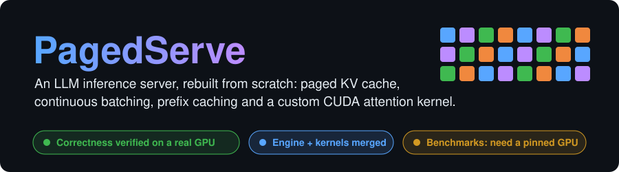
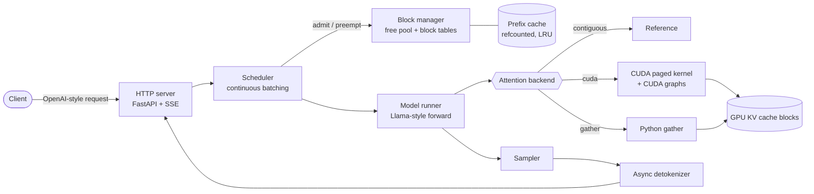
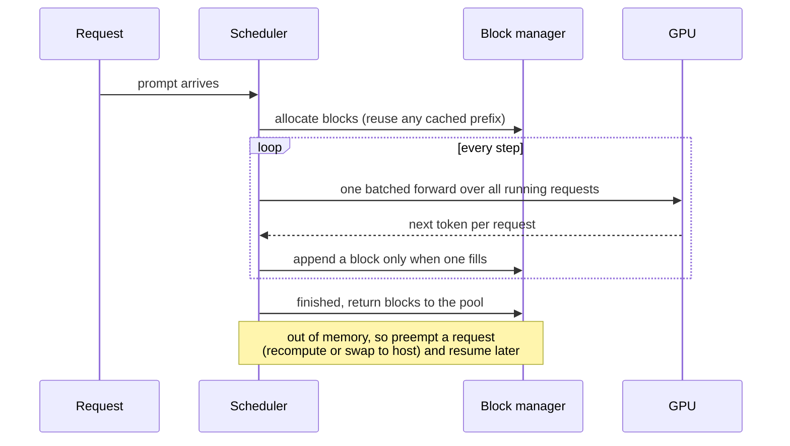

<div align="center">



[](results/verification/kaggle-t4-2026-10-14/README.md)
[](results/verification/kaggle-t4-2026-10-14/README.md)
[](results/verification/kaggle-t4-2026-10-14/README.md)
[](#results)

**[How it works](#how-paging-works)** ·
**[Run evidence](#run-evidence)** ·
**[Architecture](#architecture)** ·
**[Results](#results)** ·
**[Run it](#run-it)** ·
**[Docs](#further-reading)**

</div>

---

## What this is

When you send a prompt to a chatbot, a server has to hold many conversations in GPU memory at
once and generate tokens for all of them efficiently. That server is an **inference engine**.
The well-known ones are vLLM, TensorRT-LLM and SGLang.

PagedServe rebuilds their four core ideas from nothing, with no dependency on any of them at
runtime, so every mechanism can be explained from memory:

| Idea | What it fixes |
|---|---|
| **Paged KV cache** | Reserving worst-case memory per request wastes most of the GPU. Fixed-size blocks and a block table waste almost none. |
| **Continuous batching** | Static batches wait for the slowest request. An iteration-level scheduler admits and retires requests every step. |
| **Prefix caching** | Requests that share a prompt prefix recompute it. Shared, refcounted, LRU-evicted blocks skip the repeat work. |
| **Custom CUDA attention kernel** | Reading K and V through a block table needs a kernel that understands the table. |

<br/>

## How paging works

<div align="center">

</div>

Each request keeps a **block table** that maps its logical blocks to physical ones. Blocks need
not be contiguous, so memory is never reserved up front and a finished request hands its blocks
straight back to the pool. The measured effect on this repo's own harness:

<div align="center">

</div>

<br/>

## Run evidence

<div align="center">

</div>

Two independent notebook runs of this repository on a **Tesla T4 (sm_75, float16)**, with raw
logs committed in [`results/verification/kaggle-t4-2026-10-14/`](results/verification/kaggle-t4-2026-10-14/).

What that establishes: the hand-written CUDA kernels compile, and the engine produces the **same
tokens as HuggingFace** on a real GPU, across both attention backends, with prefix caching on
and off, and with forced preemption (recompute and swap) leaving the output unchanged.

What it does **not** establish: speed. A shared, unpinnable GPU cannot produce a reportable
timing, so nothing above is timed. See [Results](#results).

<details>
<summary><b>The exact numbers, per run</b></summary>

| Check | Result |
|---|---|
| CPU suite (`-m "not gpu"`) | 510 passed |
| CUDA extension build (nvcc, sm_75) | built and importable, 7/7 extension tests |
| GPU smoke checks | 6/6: KV profiling, swap round-trip, e2e generation, paged = contiguous bit-for-bit, preemption invisible |
| `pytest -m gpu` | 52 passed, 12 skipped (cuda-backend cases that need `device=cuda`) |
| CUDA kernel + CUDA graph + extension tests, `device=cuda` | 73 passed, 1 skipped |
| Golden suite vs HuggingFace on `device=cuda`, float16 | 58 passed, 0 skipped |
| Whole suite on `device=cuda` (minus golden) | 515 passed, 1 skipped |

The one skip applies only when the extension is not built, so it is expected here.
Environment: torch 2.11.0+cu128, CUDA 12.8, Tesla T4, float16.

</details>

<br/>

## Build status

<div align="center">

</div>

<details>
<summary><b>What each phase is, and what is verified</b></summary>

| Phase | What | State |
|---|---|---|
| 0 | Benchmark harness: load generator, percentile metrics, HuggingFace baselines | complete |
| 1 | Naive engine, contiguous KV cache | complete |
| 2 | Paged KV cache (Python gather backend) | complete |
| 3 | Continuous batching scheduler, recompute and swap preemption | complete |
| 4 | Custom CUDA paged-attention and cache-copy kernels | **verified on a T4** (builds, passes the CUDA tests and golden) |
| 5 | Block-aligned prefix caching | complete |
| 6 | OpenAI-compatible HTTP server with SSE streaming and full sampling | complete |
| 7 | Chunked prefill, static-batching mode, CUDA graph decode, async detokenization | **verified on a T4** (`test_cuda_graph.py` and golden pass on cuda) |
| 8 | Ablations | tooling complete (CLI flags, `bench/sweep.py`, charts); **no sweep run** |
| 9 | Writeup | design, vLLM gap and Q&A docs written; results await a sweep |

</details>

<br/>

## Architecture





<br/>

## Results

> **No performance has been measured yet, and none is claimed.**

This is deliberate. The rule in [`AGENTS.md`](AGENTS.md) §2.1 is absolute: every number in this
repository must trace to a committed raw result JSON under `results/`, produced by a script in
`bench/`, on named hardware. Timings from the shared Kaggle GPU above do not qualify, because it
cannot be pinned.

The sweep tooling is finished and rehearsed end to end off the GPU; what remains is one run on
a pinned GPU.

<details>
<summary><b>What the sweeps will produce</b></summary>

| Sweep | Question it answers |
|---|---|
| `arms` | Which feature caused which gain: paging, continuous batching, prefix cache, the CUDA kernel. |
| `block-size` | Why block size 16: the fragmentation versus kernel-efficiency trade-off. |
| `preemption` | Recompute versus swap under memory pressure. |
| `prefix` | Time to first token with and without a shared prefix. |

```bash
python -m bench.sweep {arms,block-size,preemption,prefix} --help
scripts/make_charts.sh results docs/charts
```

</details>

<br/>

## Run it

```bash
pip install -e ".[all]"                 # base install is light; [engine] torch, [baseline] transformers, [server] FastAPI
python setup.py build_ext --inplace     # optional CUDA extension; never through pip (isolated build has no torch)
```

```bash
python -m pagedserve.server --model Qwen/Qwen2.5-0.5B-Instruct --num-blocks 512 \
    [--attn-backend {contiguous,gather,cuda}] [--no-paging] [--static-batching] \
    [--enable-prefix-caching] [--enable-chunked-prefill] [--enable-cuda-graphs] \
    [--preemption-policy {recompute,swap}]
```

`--attn-backend` defaults to `cuda` when the extension is built and a GPU is present, else
`gather`. Pass `--num-blocks` explicitly for any run that must not run out of memory.

<details>
<summary><b>Reproduce the GPU verification yourself, free, on Kaggle</b></summary>

Open a Kaggle notebook with a **GPU** and **Internet on**, then run:

```python
!bash <(curl -sSL https://raw.githubusercontent.com/Vivek-Chaudhari30/Paged_Serve/main/scripts/kaggle_bootstrap.sh)
```

It builds the CUDA extension and runs the smoke checks and the golden test on the GPU.
Use **Save Version → Save & Run All** and it keeps running with your laptop closed.

</details>

<details>
<summary><b>Development and tests</b></summary>

```bash
ruff check . && ruff format --check .
pytest -m "not gpu"
```

On a GPU machine, `pytest -m gpu` selects only the tests that cannot run without CUDA. It is
**not** the full GPU suite and the golden gate is not in it. Run the whole suite against the GPU:

```bash
PAGEDSERVE_TEST_DEVICE=cuda PAGEDSERVE_TEST_DTYPE=float16 pytest
```

</details>

<br/>

## Scope

Single GPU, one Llama-style architecture family (RoPE, GQA, SwiGLU, RMSNorm), unquantized
weights. Tensor and pipeline parallelism, quantization, broad model support and speculative
decoding are out of scope on purpose: this project is about KV memory management, and those are
different bottlenecks.

## Further reading

- [`docs/how-it-works.md`](docs/how-it-works.md): a plain-language explanation of the whole system.
- [`docs/design.md`](docs/design.md): design decisions and why.
- [`docs/vllm-gap.md`](docs/vllm-gap.md): where this is slower than vLLM, and why.
- [`docs/interview-notes.md`](docs/interview-notes.md): the questions this project should survive.
- [`docs/aws-runbook.md`](docs/aws-runbook.md): running the benchmark on AWS.
- [`AGENTS.md`](AGENTS.md): the rules every contributor and coding agent works under.
